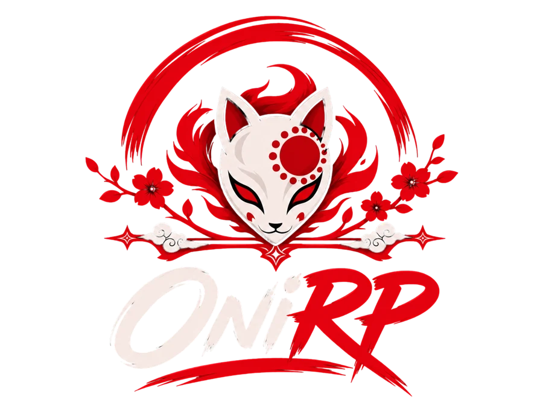
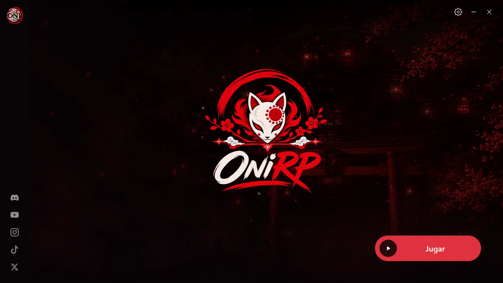
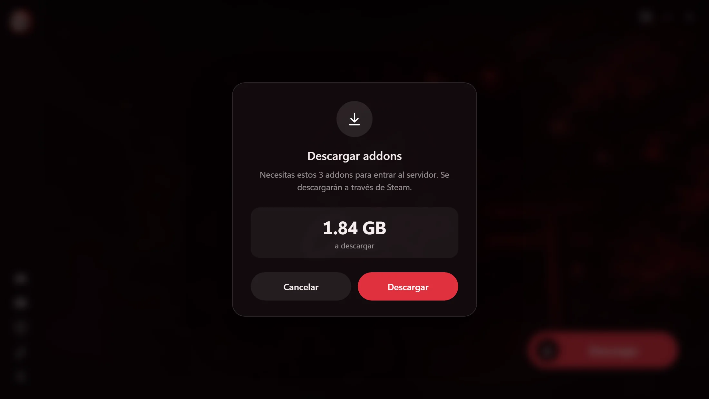
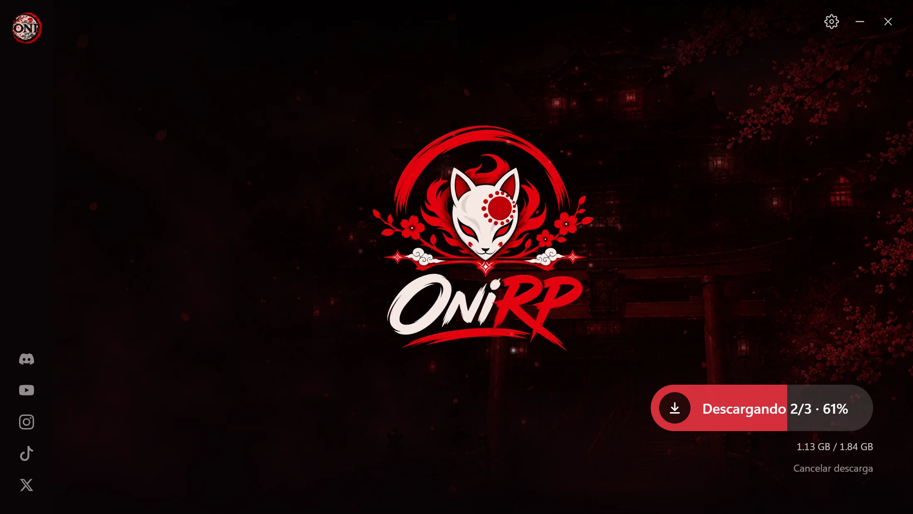
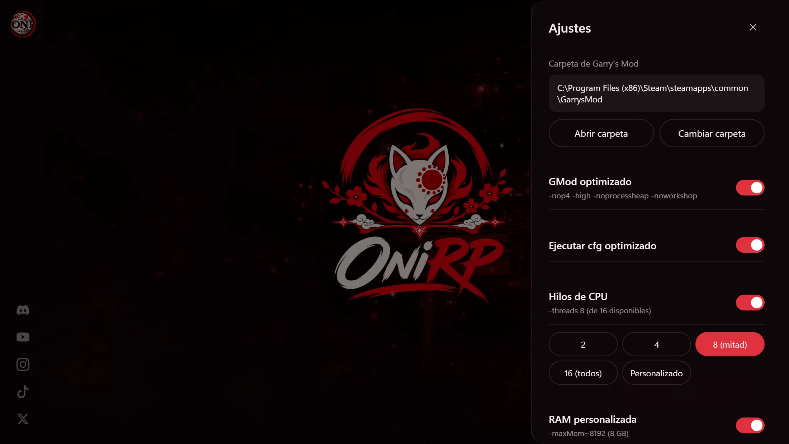

<<<<<<< HEAD

  

<h1 align="center">OniRP Launcher</h1>

  Launcher oficial de <b>OniRP</b>, servidor de rol de Kimetsu No Yaiba en Garry's Mod. 
  Descarga los addons del servidor a través de Steam, avisa cuando hay actualizaciones y abre el juego con un botón.

  <a href="https://github.com/x04000/OniRP-Launcher/releases/latest"><b>Descargar para Windows</b></a>

  

## Instalación

1. Descarga el instalador `.exe` desde [la última versión](https://github.com/x04000/OniRP-Launcher/releases/latest), en el apartado **Assets**.
2. Ábrelo. Si Windows SmartScreen muestra un aviso, pulsa **Más información** y luego **Ejecutar de todas formas**.
3. Abre Steam con tu cuenta. El launcher lo usa unos segundos para comprobar y descargar los addons.
4. Pulsa el botón del launcher: descarga lo que falte y, cuando ponga **Jugar**, ya puedes entrar.

**Necesitas:** Windows 10 u 11, Steam con la sesión iniciada y Garry's Mod en tu biblioteca.

## Qué hace

**Un botón que sabe en qué punto estás.** Al abrirse comprueba tu carpeta de Garry's Mod y los addons del servidor, y el botón principal muestra el único paso que falta:

| Estado | Cuándo aparece |
|---|---|
| Comprobando | Mientras lee tus librerías de Steam y el estado de cada addon |
| Elegir GMod | Si no encuentra Garry's Mod en ninguna librería |
| Descargar | Faltan addons del servidor |
| Actualizar | Algún addon tiene una versión nueva en la Workshop |
| Jugar | Todo está al día |

Si vuelves al launcher después de un rato, lo comprueba otra vez por su cuenta.

**Descarga de addons por Steam.**
- Antes de empezar te enseña cuánto ocupa la descarga.
- El propio botón hace de barra de progreso, con lo descargado y la velocidad.
- Puedes cancelar a mitad.
- Al actualizar, Steam solo baja lo que ha cambiado.
- Desde Ajustes puedes desinstalar los addons de OniRP.

**Ajustes de arranque.** Cada opción se convierte en un parámetro de `gmod.exe`:

| Ajuste | Parámetros |
|---|---|
| GMod optimizado | `-nop4 -high -noprocessheap -noworkshop` |
| Hilos de CPU | `-threads N` (por defecto, la mitad de los hilos del procesador) |
| RAM personalizada | `-maxMem=MB` (de 2 a 32 GB, o un valor propio) |
| Ejecutar cfg optimizado | `+exec horizonlauncher.cfg` |

El cfg se escribe en `garrysmod/cfg/horizonlauncher.cfg` con: `gmod_mcore_test 1`, `mat_queue_mode 2`, `mat_antialias 0`, `mat_forcehardwaresync 0`, `mat_specular 1`, `cl_threaded_bone_setup 0` y `fps_max 0`.

**Y además:**
- Encuentra Garry's Mod en todas tus librerías de Steam. Si está en otro sitio, lo eliges una vez y se acuerda.
- Muestra «Kimetsu No Yaiba Roleplay» en tu estado de Discord, con un botón al Discord del servidor.
- Avisa al abrirlo si hay una versión más reciente del launcher.
- Enlaces a Discord, YouTube, Instagram, TikTok y X en la barra lateral.

## Capturas

| Confirmar descarga | Descargando | Ajustes |
|---|---|---|
|  |  |  |

*El número de addons y los tamaños de las capturas son de ejemplo.*

---

  <a href="https://github.com/x04000/OniRP-Launcher/releases/latest"><b>Descargar el launcher</b></a> · <a href="https://discord.gg/jse95YYwAZ">Discord de OniRP</a>

=======

  

<h1 align="center">OniRP Launcher</h1>

  Launcher oficial de <b>OniRP</b>, servidor de rol de Kimetsu No Yaiba en Garry's Mod. 
  Descarga los addons del servidor a través de Steam, avisa cuando hay actualizaciones y abre el juego con un botón.

  <a href="https://github.com/x04000/OniRP-Launcher/releases/latest"><b>Descargar para Windows</b></a>

  

## Instalación

1. Descarga el instalador `.exe` desde [la última versión](https://github.com/x04000/OniRP-Launcher/releases/latest), en el apartado **Assets**.
2. Ábrelo. Si Windows SmartScreen muestra un aviso, pulsa **Más información** y luego **Ejecutar de todas formas**.
3. Abre Steam con tu cuenta. El launcher lo usa unos segundos para comprobar y descargar los addons.
4. Pulsa el botón del launcher: descarga lo que falte y, cuando ponga **Jugar**, ya puedes entrar.

**Necesitas:** Windows 10 u 11, Steam con la sesión iniciada y Garry's Mod en tu biblioteca.

## Qué hace

**Un botón que sabe en qué punto estás.** Al abrirse comprueba tu carpeta de Garry's Mod y los addons del servidor, y el botón principal muestra el único paso que falta:

| Estado | Cuándo aparece |
|---|---|
| Comprobando | Mientras lee tus librerías de Steam y el estado de cada addon |
| Elegir GMod | Si no encuentra Garry's Mod en ninguna librería |
| Descargar | Faltan addons del servidor |
| Actualizar | Algún addon tiene una versión nueva en la Workshop |
| Jugar | Todo está al día |

Si vuelves al launcher después de un rato, lo comprueba otra vez por su cuenta.

**Descarga de addons por Steam.**
- Antes de empezar te enseña cuánto ocupa la descarga.
- El propio botón hace de barra de progreso, con lo descargado y la velocidad.
- Puedes cancelar a mitad.
- Al actualizar, Steam solo baja lo que ha cambiado.
- Desde Ajustes puedes desinstalar los addons de OniRP.

**Ajustes de arranque.** Cada opción se convierte en un parámetro de `gmod.exe`:

| Ajuste | Parámetros |
|---|---|
| GMod optimizado | `-nop4 -high -noprocessheap -noworkshop` |
| Hilos de CPU | `-threads N` (por defecto, la mitad de los hilos del procesador) |
| RAM personalizada | `-maxMem=MB` (de 2 a 32 GB, o un valor propio) |
| Ejecutar cfg optimizado | `+exec horizonlauncher.cfg` |

El cfg se escribe en `garrysmod/cfg/horizonlauncher.cfg` con: `gmod_mcore_test 1`, `mat_queue_mode 2`, `mat_antialias 0`, `mat_forcehardwaresync 0`, `mat_specular 1`, `cl_threaded_bone_setup 0` y `fps_max 0`.

**Y además:**
- Encuentra Garry's Mod en todas tus librerías de Steam. Si está en otro sitio, lo eliges una vez y se acuerda.
- Muestra «Kimetsu No Yaiba Roleplay» en tu estado de Discord, con un botón al Discord del servidor.
- Avisa al abrirlo si hay una versión más reciente del launcher.
- Enlaces a Discord, YouTube, Instagram, TikTok y X en la barra lateral.

## Capturas

| Confirmar descarga | Descargando | Ajustes |
|---|---|---|
|  |  |  |

*El número de addons y los tamaños de las capturas son de ejemplo.*

---

  <a href="https://github.com/x04000/OniRP-Launcher/releases/latest"><b>Descargar el launcher</b></a> · <a href="https://discord.gg/jse95YYwAZ">Discord de OniRP</a>

>>>>>>> d2ca5c95ebec3c7e0ac9af44e85d69dfb217f0f6
